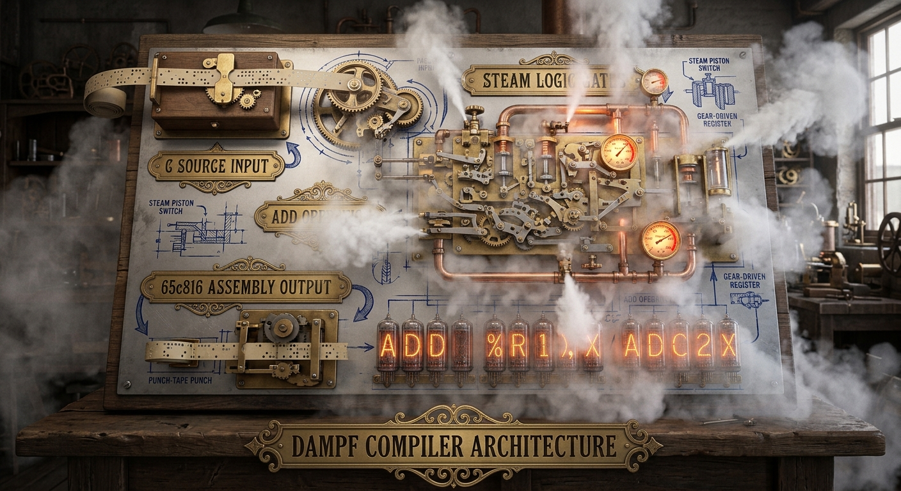

# superdevkit

> This is still an alpha release. It works for me, that doesn't necessarily mean it works for you at the moment. Sorry 😔.

A development kit for SNES games written in C. A game is written once, against the kit's console
API, and runs on the Super Nintendo and, with the same picture pixel for pixel, as a program for
Linux and Windows and as a page in the browser. The kit holds:

- **dampf**, the compiler: a subset of C to fast code for the WDC 65816, with the SNES as its one
  target (see [dampf](#dampf) below);
- the **library** ([lib](lib/README.md)): the console API in C for the SNES, and
  [Rachael](lib/README.md#rachael), the SNES rebuilt in portable C, with a desktop frontend
  (a window, the keyboard and gamepads, recordings and replays) that also runs in the browser;
- the **`superdevkit` command**, which builds a game for every target and converts its pictures
  (`superdevkit png`) and sound effects (`superdevkit sfx`);
- the **tools** ([tools](tools/README.md)): the editor of a game's sound effects (BRR Lab,
  [docs/sound.md](docs/sound.md)) and the rename script;
- **examples** ([examples](examples/)): games and programs, from `hello` to the shooter
  Er-Tüp, which are also the kit's test cases and its benchmark;
- the **book** ([docs/book](docs/book)): the user guide and the reference.

Status: version 0.9.0 in development (M9, the optimizer); the last release is 0.8.0. Milestones
M0 to M8 are done: M6 is dampf's own assembler and
linker; with M5 Blubber Blasen (the kit's first user, a game in its own repository) builds its
ROM with the kit and plays its recordings with the PC's checksums; with M7 a game builds and runs
on the SNES, Linux and Windows with the `superdevkit` command, with sound effects, save RAM, music
on the desktop and a debug view; with M8 it runs in the browser too (`superdevkit build web`). The
milestones and versions are in [docs/roadmap.md](docs/roadmap.md), why the kit is the project and
dampf its compiler in [ADR-6F3CJX8T](docs/adr/6F3CJX8T-superdevkit-is-the-project-and-dampf-is-its.md).

`./gradlew installDist` writes a superdevkit home to `build/install/superdevkit`: the compiler,
the library, the tools, the examples, the desktop build and the book, all a game needs. A game
lives in a folder of its own and names the home; the book's
[Getting started](docs/book/guide/getting-started.md) shows how.

## dampf



The name: in German, *Dampf machen* ("make steam") means to get things moving fast. It also fits
the steam factory of Blubber Blasen.

dampf compiles all of Blubber Blasen and built a playable ROM of it, with the console API written
in C in [lib/snes](lib/snes/README.md) (save RAM and sound effects came after the game left,
[docs/sound.md](docs/sound.md)). During play the
game took 0.79 frames per tick ([docs/optimizations.md](docs/optimizations.md#where-things-stand)). Since
2026-11-19 the kit's own examples (`examples/`) are dampf's test cases and its benchmark
(`dev/bench_examples.sh`), and the game's code is no longer in this repository
([ADR-6F60Z819](docs/adr/6F60Z819-the-examples-replace-blubber-blasen-s-snapshot-as.md)). dampf computes a best and a
worst case in CPU cycles for every function, and a function over its cycle budget
(`DAMPF_BUDGET`) fails the build ([docs/timing.md](docs/timing.md)). The naive code generator,
straight from the AST, stays as an independent reference (`--backend naive`): every test program
is built with both and compared with the PC (clang).

### Why

The game's stage 3 needs a C compiler for the 65816 that makes fast code. Of the existing ones,
Calypsi makes faster code than 816-tcc, PVSnesLib's compiler, and dampf's code is faster than
Calypsi's. The other ways were no better:

| Way | Result |
| --- | --- |
| llvm-mos | Good 6502 code, but no native 16-bit 65816 code generation. LLVM is a poor fit: it assumes many uniform registers and fixed-width values, while on the 65816 the operand width (8 or 16 bit) is processor state set by `REP`/`SEP`. |
| Hand-written assembly for the whole game | Tried years ago and failed. Hand-written assembly for a few hot functions stays possible later, but should not be the plan. |

We do not need a general C compiler. We need a compiler that makes SNES games fast. That is a much
smaller and more focused problem, and it lets dampf make assumptions no general compiler can:

- One CPU, one target. No portability layers.
- A subset of C we define ourselves, and a checker that enforces it, so every assumption the
  optimizer makes is guaranteed.
- The whole program is always compiled at once, so every optimization sees everything (call
  graph, all uses of every variable).
- Hints in the source (as macros) give the compiler knowledge it cannot infer.
- C is only the contract that keeps the same source compiling on the PC with gcc or clang. That is
  what makes the code testable.

### Goals and non-goals

Goals:

1. Fast 65816 code for SNES game logic: the game logic of Blubber Blasen's busiest scene fits in
   at most 60 % of a frame.
2. The same source compiles on the PC with gcc/clang and behaves **bit-identically** on both sides.
3. Source-level debugging of the C code in Mesen.
4. Readable output: the generated assembly is commented so a human can follow what each part is
   meant to do.
5. Correctness first: every optimization is checked automatically against a reference.
6. Nothing to install but Java. dampf preprocesses, assembles and links with its own preprocessor,
   assembler and linker.

Non-goals:

- Full C, or C standard conformance beyond the subset.
- Other CPUs or targets. The code keeps the 65816 core and the SNES target apart, but nothing is
  built for a second target.
- An own debugger. dampf uses Mesen.
- Floating point.
- Fast compilation. A game this size compiles in seconds either way.

## Documents

The user book is in [docs/book](docs/book) (there `npm install`, then `npm run docs:dev`); its pages
are generated from the specs in [doc-specs](doc-specs/README.md). The documents below are the
working documents it is written from.

- [docs/ADR.md](docs/ADR.md): the architecture decision records, why dampf is built the way it is; one file per record in [docs/adr](docs/adr).
- [docs/architecture.md](docs/architecture.md): the pipeline, the three IR levels, core and target, the assembly output.
- [docs/subset.md](docs/subset.md): the C subset, derived from what the game uses, and the decisions about it.
- [docs/hints.md](docs/hints.md): hints that tell dampf what a human assembly programmer would know.
- [docs/subrange-types.md](docs/subrange-types.md): design proposal for subrange types (`DAMPF_RANGED`) and inferred value ranges; what is built of it is in optimizations.md.
- [docs/optimizations.md](docs/optimizations.md): where things stand, the optimization catalogue, the gap to hand-written assembly.
- [docs/optimizations-log.md](docs/optimizations-log.md): dated measurements of each optimization step.
- [docs/timing.md](docs/timing.md): exact timing, worst-case bounds and cycle budgets.
- [docs/archive](docs/archive): finished plans and reviews, kept as they were (the way to LIR and to dampf's own assembler and linker, the status review of 2026-11-18, the compiler flaws measured on 2026-11-20 and fixed by 2026-11-21, the plan from dampf to superdevkit with its SNES, desktop and web targets).
- [docs/memory-map.md](docs/memory-map.md): where code, data, variables and pointers live.
- [docs/testing.md](docs/testing.md): the test layers and how they work.
- [docs/testing-ideas.md](docs/testing-ideas.md): how the large compilers are tested, and eight kinds of tests dampf does not have yet, as steps.
- [docs/brainstorm](docs/brainstorm): summaries of brainstorming sessions, the options weighed before a decision.
- [docs/roadmap.md](docs/roadmap.md): milestones and their state, risks, open questions, the relation to Blubber Blasen.
- [dev/README.md](dev/README.md): the scripts in `dev/`, for developing the kit against the examples.

## Prerequisites

To use the kit: JDK 25 or newer; for the desktop build also a C compiler (raylib is fetched on the
first build), for the web Emscripten's `emcc`, and Python 3 only for the rename script in
`tools/`. To develop it, also clang, ca65 and ld65 from cc65 2.19
(`BackendOutputTest` builds the execution tests, 20 random programs and the examples with them
as well and compares the ROMs) and Python 3; clang is the tests' reference on the PC and is used
by `dev/subset_scan.py`. Mesen (MesenCE) is optional (the tests then also run there),
Node.js only for the book and the browser tests (the BRR Lab's,
[tools/lab_test](tools/lab_test/README.md), and the examples' on the web,
[tools/web_check](tools/web_check/README.md), with Playwright; the web's also with Emscripten). Gradle comes with the wrapper. The book's
[getting started](docs/book/guide/getting-started.md) page has what a user needs.

On Arch Linux, cc65 is not in the official repositories; build it from source:

```bash
git clone --depth 1 --branch V2.19 https://github.com/cc65/cc65.git
cd cc65 && make bin && sudo make install PREFIX=/usr/local
```

## Building and testing

```bash
./gradlew build                          # compile and run the tests
./gradlew installDist                    # the launcher: build/install/superdevkit/bin/dampf
./gradlew test -Prandom=500 -PrandomSeed=1   # more random programs, from a given seed
./gradlew test -Pcoverage                # JaCoCo: build/reports/jacoco/test/html/index.html
./gradlew pmdMain pmdTest                # PMD: build/reports/pmd/ (not a gate)
./gradlew cpd                            # copied code: build/reports/cpd/main.txt
dev/bench_examples.sh                  # the benchmark: the work per tick of every example
```

The tests run in dampf's own emulator (`dampf.emu`) and, when `.mesen/` holds a Mesen (not in
git), headless in Mesen as well: `dev/fetch_mesen.sh` puts MesenCE there, the Linux and the
Windows build, with the settings the tests need ([ADR-6F3CK1V6](docs/adr/6F3CK1V6-mesence-is-the-emulator-for-the-console-checks.md)).
The Linux build is taken when it is there; from WSL the Windows `Mesen.exe` works too. All Gradle switches are listed in the book's
[testing](docs/book/inside/testing.md) page, the scripts in [dev/README.md](dev/README.md).

## Using superdevkit

A game is a folder with a `superdevkit.toml` (its name, the kit's version, its sources, pictures,
sound effects and save RAM; ADR-6F3CJZBY), and the `superdevkit` command builds it:

```bash
superdevkit init mygame --from catchme   # a new project, a copy of an example
superdevkit build snes                    # build/snes/mygame.sfc (and build/compile_commands.json)
superdevkit build linux                   # build/linux/mygame; win64 with MSVC, also from WSL
superdevkit run                           # builds the desktop program and plays it; run snes: Mesen
superdevkit run web                       # build/web/index.html (emcc), served here, in the browser
superdevkit build snes --plan             # the steps, without running them (--verbose: while running)
```

It converts the assets in Java (`superdevkit png`, `superdevkit sfx`), compiles with dampf in the
same Java for the SNES, and calls the system's C compiler for the desktop (Emscripten's `emcc` for
the web), one call per file, after fetching raylib once. A SNES build also writes `build/snes/<name>.args`, dampf's argument file of
what it compiled.

A game with converters of its own names them in `superdevkit.toml`, and every build runs them first,
in the game's folder; they may write files that `sources` lists:

```toml
[build]
before = ["./make_levels.sh"]
```

## Using dampf

```bash
dampf build --entry test_main -o build/calls.sfc compiler/src/test/resources/exec/calls.c   # one file, without the kit
superdevkit build snes examples/ertuep            # writes the argument file used below
dampf check @examples/ertuep/build/snes/ertuep.args
dampf build @examples/ertuep/build/snes/ertuep.args -o build/ertuep.sfc
```

The launcher is `build/install/superdevkit/bin/dampf` (`./gradlew installDist`).

`build` writes the ROM and next to it the generated assembly (`.s`, with the C source line and a
comment for each instruction; the naive code also shows the processor state), the debug file
(`.dbg`, in ld65's format, which Mesen reads) and a label file. `--assembler ca65` assembles and
links with ca65 and ld65 instead of dampf's own assembler and linker (the same ROM; ld65 also
writes a map file). The runtime calls the entry function after start-up (`void name(void)`, default
`main`) and writes to $21FB when it returns. With the code generator from MIR it also writes the
timing report (`.timing.txt`). `--backend naive` picks the naive code generator, `--slowrom`
builds for a SlowROM cartridge (FastROM is the default), `--sram BYTES` gives the cartridge
battery-backed save RAM (the header says so; `SDEVKIT_SRAM_SIZE` is defined), `--replace fn=file.s` links a
hand-written function ([reference](reference/README.md)) and `--block-counts` lays out the
blocks by a profile. `parse` only preprocesses and parses. `check` runs the front end on every
file alone, then on all of them together (recursion, functions defined nowhere or twice). Every
error of a run is reported, one per top-level declaration at most. `@file` (or `--config file`)
reads options from an argument file: one per line, paths relative to the file, and a folder
stands for the `.c` files in it ([ADR-6F3CJW9N](docs/adr/6F3CJW9N-options-can-be-kept-in-an-argument-file-given-by.md)).
`dampf mir`, `dampf profile` and `dampf bench` are tools for working on dampf with a benchmark
ROM that reports through their ports, such as Blubber Blasen's `bench.c` in the game's repository.

## Debugging in Mesen

Open the ROM in Mesen (MesenCE; Mesen 2 works the same) with the `.dbg` file next to it. In the debugger's integration settings,
let Mesen load `.dbg` files automatically; it then shows the C source. The debug file names the C
sources relative to itself, so keep the repository's layout. From WSL, open the ROM through
`\\wsl.localhost\...`. The book's [debugging](docs/book/guide/debugging.md) page shows how to
step through C.

## Repository layout

The top level shows what a release of superdevkit holds (ADR
[ADR-6F60Z9QJ](docs/adr/6F60Z9QJ-the-release-is-a-zip-per-system-with-a-java.md)), and the folders for
developing it. `./gradlew installDist` writes the distribution in that shape to
`build/install/superdevkit`: a superdevkit home with all a game needs (`bin/`, `java/`,
`include/`, `lib/`, `tools/`, `examples/`, the desktop build in `dev/`), so a game outside this
repository points at it. The book's [Getting started](docs/book/guide/getting-started.md) shows how;
jre/ and raylib/ come with the release zips.

```
compiler/      dampf, the compiler, with its emulator and the tests of the whole kit (Gradle subproject)
cli/           the superdevkit command: init, build, run, and the converters png and sfx (Gradle subproject)
lib/           the dev kit's library: the console API (include/), the SNES (snes/), Rachael, the
               desktop; see its README.md
tools/         tools for game developers: brr_lab.html, sdevkit_rename.py (the converters are in cli/)
examples/      the dev kit's examples: test cases and the benchmark (each has its README.md)
reference/     hand-written assembly of the examples' functions, the yardstick for dampf's code
dev/           scripts for developing the kit: benchmark, checks in Mesen, art
config/pmd/    PMD rules (./gradlew pmdMain pmdTest)
docs/          the working documents (see Documents); docs/book the user book (VitePress, with
               its package.json), mostly generated from doc-specs/; docs/assets the logo
doc-specs/     what each page of the book covers, and its sources
```

Inside `compiler/src`:

```
main/antlr/dampf/parser/       C grammar from grammars-v4 (see its README.md)
main/java/dampf/               Main (the command line) and Compiler (the pipeline)
main/java/dampf/parser/        support classes for the grammar (symbol table for typedef names)
main/java/dampf/frontend/      preprocessor call, source positions, parsing, AST builder
main/java/dampf/ast/           typed AST of the whole program
main/java/dampf/check/         subset checks (call graph, no recursion)
main/java/dampf/mir/           MIR: lowering from the AST, the passes, the interpreter
main/java/dampf/backend/       code generators (from MIR, and the naive one from the AST), timing
main/java/dampf/lir/           LIR: 65816 code in basic blocks, its text (ca65 source), verifier, passes
main/java/dampf/asm/           dampf's assembler and linker, and the debug file
main/java/dampf/target/        the 65816's cycle table
main/java/dampf/snes/          ROM build (memory map, bank packing, header; with dampf's linker or ld65)
main/java/dampf/emu/           dampf's own 65816 and SNES emulator, the examples' checks and benchmark
main/java/dampf/tools/         dampf mir, dampf bench, dampf profile
main/java/dampf/util/          running external programs
main/resources/dampf/include/  dampf's own <stdint.h>, <string.h> and <dampf.h>
main/resources/dampf/snes/     SNES runtime (start-up, header, vectors)
test/java/dampf/               unit, execution, random, example and emulator tests; book source checks
test/resources/exec/           execution test programs
test/python/                   the tests of tools/ (ToolsTest runs them)
```

## Trademarks

superdevkit is an independent project. It is not affiliated with, endorsed by or connected to
Nintendo, and it is not an official development kit. Nintendo, Super Nintendo, Super Nintendo
Entertainment System and SNES are trademarks of Nintendo; they are used here only to say which
console the kit is for. superdevkit contains no code or data of Nintendo's, and the games made with
it are their authors' own.

## Licence

superdevkit, dampf included, is under the Apache License v2.0 with LLVM Exceptions, the same
licence as LLVM (SPDX: `Apache-2.0 WITH LLVM-exception`); see [LICENSE](LICENSE) and
[NOTICE](NOTICE). The exception means that code dampf and the library put into a compiled program
carry no licence conditions: games built with the kit can use any licence. Third-party parts (the C grammar from grammars-v4) keep their
own licence, listed in NOTICE.
