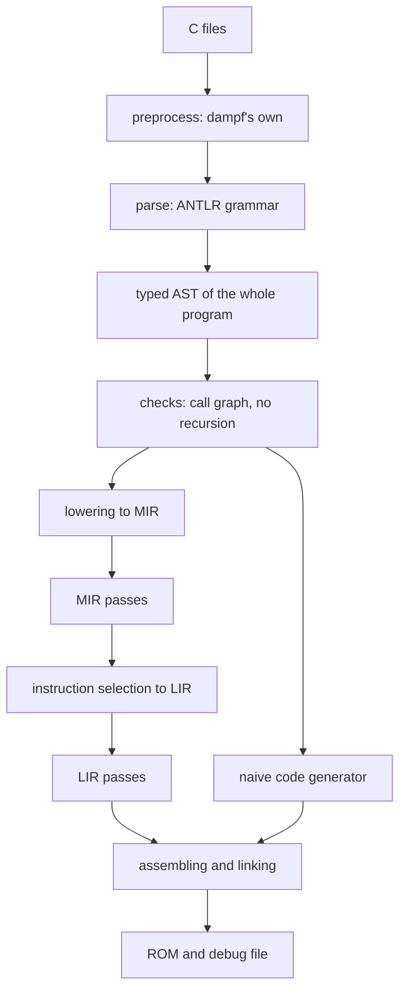

<!-- GENERATED from doc-specs/inside/how-a-compile-works.spec.md by /docs-gen. Do not edit; change the spec or its sources. -->

# How a compile works

This page follows one `dampf build` from the C files to the ROM, phase by phase, and names the
class that does each step, so that you know where to look when something goes wrong. You do
not need any of it to use dampf.

## The big picture

The class `Compiler` holds the whole pipeline: C files go in, a SNES ROM with debug
information comes out. Two code generators share the [front end](/glossary#front-end): the code
generator from [MIR](/glossary#mir), which `dampf build` uses unless you choose the naive one or
use `--replace`, and the naive code generator, which works straight from the [AST](/glossary#ast).



- **Preprocess**: dampf's preprocessor expands includes and macros, one C file at a time.
- **Parse**: an ANTLR parser turns the preprocessed text into a parse tree.
- **AST**: the parse trees of all files become one typed AST; subset violations are found here.
- **Checks**: the call graph of the whole program is built, and recursion is rejected.
- **Lowering to MIR**: each function becomes a graph of basic blocks in [SSA](/glossary#ssa)
  form.
- **Passes**: the optimizer's [passes](/glossary#pass) rewrite the MIR until nothing changes.
- **Instruction selection**: each function of the MIR becomes [LIR](/glossary#lir), 65816 code in
  basic blocks.
- **LIR passes**: loads and stores nobody needs are removed, branch forms are chosen, and the
  LIR is printed as [ca65](/glossary#ca65-and-ld65) assembly; the naive path writes that
  assembly straight from the AST.
- **Assembling and linking**: the assembly is assembled, packed into ROM
  [banks](/glossary#bank) and linked.

## Preprocess and parse

The class `Preprocessor` runs dampf's own preprocessor (`dampf.frontend.pp`) on each source
file. It does what C99 says for the directives and macros the subset needs: `#include`,
object-like, function-like and variadic macros with `#` and `##`, the conditionals with
`defined`, `#error` and `#pragma once`. Anything beyond that, such as C23's `__VA_OPT__`,
`#line`, `#include_next` or `__COUNTER__`, is an error that names it. No host header and no host
macro reaches the code: dampf's own include directory provides `<stdint.h>`, `<dampf.h>` and
`<string.h>`, and dampf searches it before the `-I` directories of the command line, as
`gcc -nostdinc -I` would. Besides the standard's macros and the `-D` macros of the command
line, it defines `__DAMPF__`, so that a header can tell the dampf build apart, and with `--sram`
it defines `SDEVKIT_SRAM_SIZE` with the bytes of save RAM. An error of the preprocessor, a
missing header for example, stops dampf at its file, line and column like any other error of
the compile.

The [PC build](/glossary#pc-build) preprocesses the same files with its own compiler. Both see
the same code because dampf's preprocessor gives the same tokens as clang's and gcc's on what it
accepts, which the tests check.

The parser comes from ANTLR 4, a tool that generates a parser in Java from a grammar. dampf
uses the C grammar of the grammars-v4 collection unchanged; only its support classes were
adapted, and the lexer no longer runs a preprocessor of its own, since dampf has preprocessed
the text already. The grammar parses C23 with GNU extensions, far more than
[the subset](/glossary#subset).

Source positions survive the preprocessor: like `gcc -E`, it writes line markers such as
`# 142 "bubble.c"` into its output, puts each token of a file at its own line and a token out of
a macro at the line of the macro's use, and `Parser` maps every position in the preprocessed
text back to the original file and line before it reports a syntax error. The same positions
travel on through the AST and MIR into the `.dbg line` directives of the assembly, which is how
[Mesen](/glossary#mesen) shows the C source while you step.

## The typed AST

The class `AstBuilder` takes the parse tree of each file in turn and builds one AST for the
[whole program](/glossary#whole-program). In the AST every expression has its type, and C's
conversions, the integer promotions among them, are made explicit, so the meaning of every
operation is fixed before any code is generated.

A `sizeof` becomes a constant here, and it has to have the value gcc gives on x86-64, because
the result must match the [PC build](/glossary#pc-build) bit for bit. dampf's pointers are 4
bytes against 8 on the PC, and dampf does not pad struct fields, so for such types dampf rejects
`sizeof` with a message. The one use it allows is the element count `sizeof a / sizeof a[0]`,
whose quotient is the same on both.

The class `AstBuilder` also reads the [hints](/glossary#hint) of `<dampf.h>`, macros that tell
dampf what it cannot infer. A `DAMPF_RANGE` statement gives the lowest and highest value of a
local variable or parameter of an integer type, with constant bounds, and becomes a statement of
its own in the AST. `DAMPF_BUDGET` in front of a function definition gives the most CPU cycles
the function may take.

The subset is enforced here, not in the grammar. A construct outside the subset parses, and
then gets a message that says what is not supported, with the position of the C source. Once
the front end is through, the checks of the next section included, `Compiler` looks up the
[entry function](/glossary#entry-function) and stops if it is missing. The execution test
`compiler/src/test/resources/exec/calls.c` names its entry function `test_main`, so without
`--entry` it fails:

```sh
dampf build -o build/calls.sfc compiler/src/test/resources/exec/calls.c
```

```
compiler/src/test/resources/exec/calls.c:1:1: error: entry function 'main' is not defined
```

With `--entry test_main` the same command builds the ROM.

## Checks on the whole program

Because dampf sees every file at once, it builds the call graph of the whole program
(`CallGraph`) and rejects recursion, direct or through other functions. Without recursion no
function runs twice at the same time, so the parameters and locals of a function can live at
fixed addresses, in its static frame.

The command `dampf check` runs the same check on the files that pass the front end, after it
has checked each file on its own; the command is on [Command line](/reference/command-line).

## MIR and its passes

dampf's design has three intermediate levels below the AST: HIR for the structure of C, MIR
for data flow and LIR for the 65816; today MIR and LIR exist, and HIR would come once splitting
arrays of structs needs it (see the [Roadmap](/inside/roadmap)).

The class `Lower` translates the AST into MIR directly: each function becomes a graph of basic
blocks in SSA form, with explicit widths and the signedness in the operations.
A `DAMPF_RANGE` becomes comparisons that branch to a block ending in `unreachable` when the hint
is wrong, and the range analysis learns the [value range](/glossary#value-range) from them.
They stay in the MIR through all passes; the code generator takes them out.

Then `Optimizer` runs the passes. On each function it repeats, until nothing changes or at
most 20 times:

1. simplification (`Simplify`),
2. tests against neighbouring constants as one range check (`RangeChecks`),
3. a bit chosen by a bit without a branch (`BitSelect`),
4. byte loads (`ByteLoads`),
5. width narrowing (`Narrow`), and narrowing with value ranges (`RangeNarrow`),
6. loop-invariant code moved before the loop (`Licm`),
7. induction variables (`Induction`),
8. pointer compression (`PointerOffsets`),
9. multiplication and division by constants (`StrengthReduce`),
10. common subexpressions and redundant loads (`Gvn`),
11. dead code and loops that do nothing removed (`DeadCode`, `DeadLoops`),
12. two loops over the rows of a table as one loop (`Collapse`).

After that round, `ParamRanges` narrows the ranges of parameters across the whole program, and
if it did, the round runs again. Then small functions are inlined (`Inline`); `Optimizer` hands
it the passes, so that it can run them on a function again before that function's callers
decide whether to inline it. Pointer parameters are compressed (`PointerParams`), and a byte
parameter that a function uses only as an index into an array of structs becomes the index
times the struct's size, which the callers compute (`IndexParams`); if any of the three changed
something, the passes run again.
Pointers that became offsets in the callers may then reach more callees, so `PointerParams` runs
once more, and `ParamRanges` after it, each followed by the passes if it changed something.
Two passes for 32-bit values come next, and the passes run again on every function they change.
`SplitWords` makes two 16-bit values of 32-bit values that are only loaded, combined bit by bit
and stored, since AND, OR and XOR never carry from one half to the other. `CompareSum` takes a
branch on a 32-bit comparison of a 16-bit value with another plus a constant, which is what C's
promotions make of `a > b + 32`. It first tests whether the sum fits 16 bits: if not, the answer
is known, and if so, a 16-bit comparison gives it.
Last, `SinkCompares` computes a comparison again right before a branch in another block that
uses it, `Schedule` sets the order of the instructions for the code generator, and the verifier
checks the result.
What MIR looks like is on [MIR](/inside/mir); what each pass does is on
[Optimizations](/inside/optimizations).

## Code generation

The [code generator from MIR](/glossary#code-generator-from-mir), `MirCodeGen`, is dampf's
main code generator. First it prepares the MIR once more: loop exits get blocks of their own
(`ExitEdges`), return blocks are copied into their predecessors (`Returns`), pointer sums are
computed again where their value is needed (`PointerRemat`), and `Hints` computes every
function's value ranges with the checks of the hints, then takes the checks out. Then it
selects the instructions of each function once (`Selection`, with one class per kind of MIR
instruction and `FrameLayout` for the places): it sets the processor modes with `REP` and `SEP`
and gives every value a place in a frame or in A, X or Y. Once every function is selected,
`RegisterChoice` moves some of the places to X or Y where that saves cycles, and
`PlaceColouring` gives the others their addresses on the code, a function's frame above the
frames of all it calls.

What instruction selection writes is LIR, the low-level intermediate representation: 65816
instructions in basic blocks, each with the accumulator width it runs in. Its text is the ca65
assembly file dampf writes, so the `.s` file next to the ROM is the LIR as the passes left it.
The LIR passes remove loads of a value a register already holds (`RedundantLoads`),
apply peephole rules (`Peephole`), run short 16-bit stretches between byte stores in 8 bits
(`ByteStretches`), run loops over bytes in 8 bits from entry to exit (`ByteLoops`), drop a
`CLC` or `SEC` where the carry is known (`KnownCarry`), remove stores nobody reads
(`DeadStores`), choose the branch forms (`BranchRelax`) and number the local labels
(`LocalLabels`). On the finished LIR, `Timing` computes the best and worst case of every
function in CPU cycles, which `dampf build` writes to a `.timing.txt` file next to the ROM.
`Compiler` then checks every function with a `DAMPF_BUDGET` against its worst case: a function
above its budget, or one without a worst case, stops the build with an error, and one above
90 % of its budget gets a warning that does not.

The [naive code generator](/glossary#naive-code-generator), `NaiveCodeGen`, translates the AST
directly, almost everything in 32-bit `int` as C's promotions say. It stays as an independent
reference: the tests compare the code generator from MIR with it. It is also the only one that
accepts `--replace`, which links a hand-written assembly version of a function in place of the
compiled one, so `--replace` without `--backend` selects it; with `--backend mir`, dampf stops
with `--replace works with the naive code generator only`. The options are on
[Command line](/reference/command-line).

Both write ca65 assembly with the source line of every C statement as a `.dbg line`
directive. Each function and each constant object goes into a segment of its own, named
`C_` or `R_` and the name, such as `C_add3`.

## Assembling and linking

The class `RomBuilder` turns the assembly into a LoROM image with dampf's own assembler and
linker (`Assembler` and `Linker` in `dampf.asm`). It writes the [runtime](/glossary#runtime) as
`dampf_runtime.s` next to the program and assembles both. The assembler reads the subset of
ca65 that dampf writes and the runtime uses, and reports anything else as an error; like ca65 it
works in one pass and chooses the size of each operand when it reads the line.

No function or constant object may cross a bank boundary, so dampf has to know every segment's
size before it can place the segments in banks. After assembling it knows them all, so one
link is enough: dampf packs the function and constant segments into the 32 KB
banks from `$80` up, largest first, each into the first bank with room, and links. The
start-up switches these banks to [FastROM](/glossary#fastrom-and-slowrom) speed, and the header
says FastROM, unless `--slowrom` builds for a SlowROM cartridge. The image is padded to a
power of two, the header gets the ROM size and the checksum, and dampf writes the
debug file in ld65's format, which Mesen reads. With `--sram`, `Compiler` then has the header
announce battery-backed save RAM, the bytes rounded up to 2, 4, 8, 16 or 32 KB, and the checksum
is computed again.

Use `--assembler ca65` to build with ca65 and ld65 instead; the ROM
is the same. With them, dampf assembles with `ca65 -g` and links twice, because it learns the
segment sizes from ld65's map file: the first link puts everything into one large area only to
read the sizes, and the second links with the packed configuration. The options are on
[Command line](/reference/command-line).

The segments and where they go:

| Segment | Where |
|---|---|
| `ZEROPAGE` | the [direct page](/glossary#direct-page), `$0000`–`$00FF` |
| `BSS` | RAM in bank `$7E` from `$2000` |
| `DATA` | initial values: stored in bank `$80`, copied to RAM |
| `STARTUP`, `DAMPF_CODE` | the runtime, in bank `$80` |
| `C_…`, `R_…` | functions and constant objects, packed into banks `$80` and up |
| `HEADER`, `VECTORS` | bank `$80` at `$FFC0` and `$FFE0` |

The runtime and the initial values must fit into bank `$80` together, and no function or
constant object may be larger than 32 KB; dampf stops with a message if either is not so.

All files go into the directory of the ROM, which dampf creates if it is missing. For
`-o build/calls.sfc` they are:

| File | What it is |
|---|---|
| `calls.sfc` | the ROM |
| `calls.dbg` | the debug file, which Mesen reads |
| `calls.lbl` | the label file |
| `calls.s` | the generated assembly |
| `dampf_runtime.s` | the runtime |
| `calls.timing.txt` | best and worst case per function (code generator from MIR only) |

With `--assembler ca65` more files join them:

| File | What it is |
|---|---|
| `calls.o`, `dampf_runtime.o` | the object files |
| `calls.cfg`, `calls.map` | linker configuration and map file of the final link |
| `calls_measure.cfg`, `calls_measure.map` | configuration and map file of the first link |

The C file names in the debug file are relative to that directory, and ca65 and ld65 run in it
with plain file names, so Mesen finds the sources wherever the ROM is opened from.

## Why it works this way

**A parser that accepts more than the subset.** The grammar parses C23 and GNU extensions
although dampf supports far less. A parse error would only say that something is wrong where
the subset checker can say what is not supported, such as recursion, with a clear message
(`docs/architecture.md`, *Pipeline*).

**An own preprocessor, assembler and linker that gain nothing for the code.** Because dampf
compiles the whole program, it already knows every instruction size and decides branch distances
itself, and it controls placement through segments, so ca65 and ld65 would build the same code;
with gcc's preprocessor the generated code of every test program and example was the same to the
byte. dampf has its own so that using it needs nothing but Java: no cc65, and no gcc, which on
Windows had meant MinGW or MSYS for the preprocessor alone. The others stay the reference: the
tests compare the preprocessor with `clang -E` on every C file dampf compiles in the repository
and on random macro programs, and build every program with both assemblers and compare the ROMs
and the debug files. The price is a preprocessor and an assembler that know only the part of C99
and of ca65 that dampf needs (`docs/architecture.md`, *Pipeline* and
*Assembly output and debugging*; ADR-6FD4GDN5 in `docs/adr/`).

**Not more than three intermediate levels.** Every level costs a lowering step, a verifier, a
text format and tests, so dampf plans three, one each for the structure of C, the data flow and
the machine, and adds another only if an optimization fits nowhere cleanly
(`docs/architecture.md`, *Deliberately not more than three*).
